# IngeniaX 2026

## Plataforma Empresarial de Gestión Comercial

### Documento de descripción funcional, técnica y de alcance

| Campo | Valor |
|---|---|
| **Producto** | IngeniaX 2026 — Plataforma Empresarial de Gestión Comercial |
| **Tipo de documento** | Descripción funcional, arquitectura, módulos, propósitos y alcance |
| **Versión** | 1.0 |
| **Fecha** | 22 de noviembre de 2026 |
| **Estado** | Visión objetivo del producto |
| **Clasificación** | Uso interno |
| **Autor** | Equipo de desarrollo IngeniaX 2026 |
| **Audiencia** | Dirección, product owners, arquitectura, desarrollo, QA y operaciones |

---

## Control del documento

### Historial de versiones

| Versión | Fecha | Autor | Descripción del cambio |
|---|---|---|---|
| 1.0 | 22/11/2026 | Equipo IngeniaX 2026 | Emisión inicial. Visión de producto, arquitectura, módulos, API, seguridad, despliegue y evolución. |

### Distribución y revisión

| Rol | Responsabilidad sobre el documento |
|---|---|
| Dirección de producto | Validar visión, alcance y prioridades |
| Arquitectura | Validar decisiones técnicas y restricciones |
| Desarrollo | Usar la especificación como referencia de implementación |
| QA | Derivar casos de prueba de módulos y flujos |
| Operaciones | Validar requisitos de despliegue y operación |

### Convenciones de redacción

- **Debe**: requisito obligatorio para considerar el producto conforme.
- **Debería**: recomendación fuerte; su omisión requiere justificación.
- **Puede**: capacidad opcional o configurable.
- Los términos técnicos se definen en el glosario (capítulo 15).
- Las rutas de API se expresan relativas al host de la API, con el prefijo `/api`.
- No se incluyen secretos, cadenas de conexión ni claves en este documento. Solo se nombran las claves de configuración.

---

## Contenido

1. Resumen ejecutivo
2. Introducción
3. Visión del producto
4. Objetivos y propósitos
5. Alcance
6. Arquitectura y tecnología
7. Módulos y funcionalidades
8. Modelo de datos
9. API y contratos
10. Seguridad
11. Flujos clave
12. Requisitos no funcionales
13. Despliegue y operación
14. Modelo de evolución del producto
15. Glosario
16. Referencias
17. Anexos

---

# 1. Resumen ejecutivo

**IngeniaX 2026** es una plataforma web empresarial para la **gestión comercial de extremo a extremo**. Integra en una sola aplicación la administración de usuarios y roles, el catálogo de productos, la gestión de clientes, el cobro en línea y la comunicación en tiempo real con los usuarios de la organización. La solución se construye sobre una arquitectura por capas, con una API REST como núcleo y una interfaz de usuario moderna, segura y adaptable.

El producto nace como una base tecnológica reutilizable para pequeñas y medianas organizaciones que necesitan ordenar su operación comercial sin incurrir en la complejidad de un ERP completo. Su propuesta de valor se apoya en cuatro pilares:

1. **Centralización**: una sola fuente de verdad para usuarios, clientes, productos y pagos.
2. **Control de acceso**: autenticación con tokens y autorización por rol y estado de cuenta.
3. **Operación en tiempo real**: notificaciones inmediatas de eventos relevantes del negocio.
4. **Extensibilidad**: arquitectura modular que permite incorporar nuevos dominios sin reescribir el núcleo.

| Dimensión | Descripción |
|---|---|
| **Usuarios objetivo** | Administradores de negocio, operadores comerciales y clientes |
| **Canal** | Aplicación web responsiva; API REST consumible por futuros clientes |
| **Módulos** | Autenticación, usuarios, clientes, productos, pagos, notificaciones, experiencia compartida y navegación |
| **Tecnología** | ASP.NET Core 10, Angular 22, SQL Server, Entity Framework Core 10, SignalR, Stripe, SendGrid y Azure Blob Storage |
| **Modelo de despliegue** | SPA + API en un mismo origen lógico, con servicios externos gestionados |
| **Estado** | Visión objetivo con una línea base funcional implementada |

La plataforma está diseñada para **crecer por incrementos**: cada módulo expone contratos claros, se apoya en servicios transversales y puede evolucionar de forma independiente. El capítulo 14 describe los horizontes de evolución previstos para consolidar la visión.

---

# 2. Introducción

## 2.1 Propósito del documento

Este documento describe **qué es, qué hace, cómo está construido y hasta dónde llega** IngeniaX 2026. Su propósito es servir como referencia única para alinear a las partes interesadas en torno a:

- la visión y los propósitos del producto;
- las funcionalidades y módulos que lo componen;
- la arquitectura y las decisiones tecnológicas;
- los contratos de la API y el modelo de datos;
- el modelo de seguridad y los requisitos no funcionales;
- el alcance comprometido y el modelo de evolución.

## 2.2 Alcance del documento

El documento cubre la **visión objetivo** del producto y su línea base técnica. Incluye la descripción funcional de todos los módulos previstos, la arquitectura de referencia, los flujos principales, los requisitos de calidad y el plan de despliegue. No sustituye a los manuales de usuario, a los contratos legales ni a la documentación operativa específica de cada organización.

## 2.3 Audiencia y lectura recomendada

| Perfil | Capítulos recomendados |
|---|---|
| Dirección y negocio | 1, 3, 4, 5, 14 |
| Product owners y analistas | 1, 3, 5, 7, 11, 14 |
| Arquitectura y desarrollo | 6, 7, 8, 9, 10, 11, 12, 13 |
| QA | 5, 7, 9, 11, 12 |
| Operaciones y seguridad | 9, 10, 12, 13 |

## 2.4 Estructura del documento

El documento se organiza en cuatro bloques:

1. **Contexto y estrategia** (capítulos 1 a 5): visión, propósitos y alcance.
2. **Diseño de la solución** (capítulos 6 a 11): arquitectura, módulos, datos, API, seguridad y flujos.
3. **Calidad y operación** (capítulos 12 y 13): requisitos no funcionales y despliegue.
4. **Evolución y referencia** (capítulos 14 a 17): roadmap, glosario, referencias y anexos.

---

# 3. Visión del producto

## 3.1 Contexto y oportunidad

Muchas organizaciones pequeñas y medianas gestionan su operación comercial con una combinación de hojas de cálculo, correo electrónico y herramientas desconectadas. Esta fragmentación produce duplicidad de datos, pérdida de trazabilidad, errores en el cobro y una experiencia inconsistente para el cliente.

IngeniaX 2026 responde a esa realidad con una plataforma **integrada, ligera y extensible** que cubre el ciclo comercial básico: identificar al cliente, mantener el catálogo, controlar el acceso del equipo, cobrar en línea y comunicar eventos en tiempo real. La solución prioriza la **claridad operativa** sobre la complejidad funcional, de modo que una organización pueda adoptarla sin una consultoría prolongada.

## 3.2 Declaración de visión

> Ser la base tecnológica que permita a una organización gestionar su operación comercial de extremo a extremo, con acceso seguro por roles, información confiable, pagos en línea y comunicación inmediata, en una plataforma modular que crezca al ritmo del negocio.

## 3.3 Problema y propuesta de valor

| Problema | Consecuencia | Respuesta del producto |
|---|---|---|
| Información dispersa | Decisiones lentas y datos inconsistentes | Fuente única para usuarios, clientes y productos |
| Accesos sin control | Riesgo de fraude y pérdida de datos | Autenticación JWT y autorización por rol y estado |
| Catálogo desactualizado | Ventas perdidas y errores de precio | CRUD de productos con imágenes, precios y existencias |
| Cobro manual | Fricción y errores de conciliación | Checkout hospedado de Stripe con confirmación |
| Comunicación tardía | Reacción lenta a eventos del negocio | Notificaciones en tiempo real con SignalR |
| Crecimiento bloqueado | Reescrituras costosas | Arquitectura modular, API-first y capas desacopladas |

## 3.4 Perfiles de usuario y roles

| Perfil | Rol del sistema | Necesidades principales | Capacidades |
|---|---|---|---|
| **Administrador** | `Admin` (1) | Control total de la operación y del equipo | Gestionar usuarios, clientes y productos; consultar pagos; recibir notificaciones |
| **Cliente / Operador** | `Cliente` (2) | Acceso a las funciones comerciales habilitadas | Consultar catálogo, operar productos y clientes según permisos, iniciar pagos |
| **Visitante** | Sin sesión | Acceder al inicio de sesión y recuperar acceso | Login y restablecimiento de contraseña |

El modelo de roles es **extensible**: la enumeración `RolUsuario` y las políticas de autorización permiten incorporar nuevos perfiles (por ejemplo, supervisor, auditor o vendedor) sin alterar el núcleo.

## 3.5 Principios de diseño del producto

1. **API-first**: toda funcionalidad relevante se expone mediante contratos REST versionables.
2. **Seguridad por defecto**: los endpoints se protegen de forma explícita; el acceso mínimo es la norma.
3. **Modularidad por dominio**: autenticación, usuarios, clientes, productos y pagos evolucionan por separado.
4. **Consistencia de experiencia**: componentes compartidos, mensajes homogéneos y navegación predecible.
5. **Trazabilidad**: fechas de creación y actualización, estados y registros de eventos.
6. **Escalabilidad**: API sin estado, almacenamiento externo de archivos y notificaciones desacopladas.
7. **Documentación viva**: OpenAPI, este documento y el código como fuentes sincronizadas.
8. **Accesibilidad e internacionalización**: interfaz en español, adaptable y preparada para nuevos idiomas.

## 3.6 Capacidades clave

| Capacidad | Valor para el negocio |
|---|---|
| Gestión de identidades y sesiones | Acceso seguro y personalizado por rol |
| Administración de usuarios | Alta, edición, estado y recuperación de cuentas |
| Gestión de clientes | Registro y seguimiento de la relación comercial |
| Catálogo de productos | Información confiable de precio, existencia e imagen |
| Búsqueda paginada | Localización rápida de registros en volúmenes crecientes |
| Cobro en línea | Conversión ágil y experiencia de pago reconocida |
| Notificaciones en tiempo real | Reacción inmediata ante eventos del negocio |
| Almacenamiento de archivos | Imágenes disponibles y desacopladas del servidor |
| Correo transaccional | Comunicación automatizada con el usuario |

## 3.7 Indicadores de éxito

| Indicador | Meta de referencia |
|---|---|
| Tiempo de alta de un usuario | Menos de 2 minutos |
| Tiempo de publicación de un producto | Menos de 3 minutos |
| Conversión del checkout | Superior al 70 % de sesiones iniciadas |
| Disponibilidad mensual | 99.5 % o superior |
| Latencia percibida en búsquedas | Menos de 500 ms en el percentil 95 |
| Notificaciones entregadas en tiempo real | 99 % en menos de 2 segundos |
| Incidentes de seguridad críticos | Cero por trimestre |

---

# 4. Objetivos y propósitos

## 4.1 Objetivo general

Proporcionar una plataforma web empresarial que integre la gestión de usuarios, clientes, productos y pagos en un entorno seguro, trazable y en tiempo real, con una arquitectura modular preparada para evolucionar hacia nuevas capacidades de negocio.

## 4.2 Objetivos específicos

1. **Centralizar la operación comercial** en una única aplicación con datos consistentes.
2. **Controlar el acceso** mediante autenticación fuerte y autorización granular por rol y estado.
3. **Digitalizar el catálogo** con información completa, imágenes y control de existencias.
4. **Habilitar el cobro en línea** con una pasarela reconocida y un flujo claro de confirmación.
5. **Comunicar eventos del negocio** de forma inmediata mediante notificaciones en tiempo real.
6. **Automatizar la comunicación** con los usuarios a través de correo transaccional.
7. **Ofrecer una experiencia consistente** en escritorio y dispositivos móviles.
8. **Facilitar la evolución** mediante contratos estables, capas desacopladas y documentación técnica.

## 4.3 Objetivos técnicos

| Objetivo | Criterio de logro |
|---|---|
| Arquitectura por capas | Separación efectiva entre presentación, API, dominio y persistencia |
| Contratos tipados | Modelos de entrada y salida explícitos; sin `any` en el frontend |
| Inyección de dependencias | Repositorios y servicios registrados en el contenedor |
| Seguridad | JWT validado, políticas de autorización y transporte cifrado |
| Observabilidad | Registro estructurado, correlación y verificación de salud |
| Calidad | Pruebas automatizadas, análisis estático y compilación reproducible |
| Operación | Despliegue repetible, configuración por entorno y respaldo verificable |

## 4.4 Objetivos académicos y formativos

El proyecto se origina en el programa **IngeniaX 2026** como ejercicio de aplicación integral de ingeniería de software. Sus objetivos formativos son:

- aplicar un ciclo completo de producto: análisis, diseño, implementación, pruebas y despliegue;
- integrar tecnologías de frontend, backend, base de datos y servicios cloud;
- practicar seguridad, calidad y documentación técnica;
- construir una base reutilizable que trascienda el ejercicio académico.

---

# 5. Alcance

## 5.1 Alcance funcional

| Módulo | Funcionalidades incluidas | Actores |
|---|---|---|
| **Autenticación y sesión** | Inicio de sesión, emisión y validación de JWT, cierre de sesión, restablecimiento de contraseña, guards de ruta | Todos |
| **Usuarios** | Alta, consulta, edición, cambio de estado, cambio de contraseña, rol, imagen de perfil, búsqueda paginada | Administrador |
| **Clientes** | Alta, consulta, edición, estado, búsqueda y ficha del cliente | Administrador, Operador |
| **Productos** | Alta, consulta, edición, eliminación lógica, imagen local o en Blob, búsqueda con filtro, orden y paginación | Administrador, Operador |
| **Pagos** | Checkout hospedado, selección de cantidad, retorno de éxito o cancelación | Cliente |
| **Notificaciones** | Conexión SignalR autenticada, notificaciones por usuario, reconexión automática | Usuarios autenticados |
| **Experiencia compartida** | Carga, modales, chips de estado, validación de formularios, estados vacíos, descargas | Todos |
| **Navegación y perfil** | Layout principal, barra lateral, barra superior, perfil y cierre de sesión | Usuarios autenticados |

## 5.2 Alcance técnico

- **Frontend**: aplicación SPA con Angular 22, TypeScript 6, Angular Material y Bootstrap; enrutamiento con carga diferida, guards de autenticación y rol, servicios de dominio y cliente HTTP centralizado.
- **Backend**: API REST en ASP.NET Core 10 con controladores, repositorios, servicios transversales, validación de modelos y respuestas uniformes.
- **Persistencia**: SQL Server mediante Entity Framework Core 10, migraciones versionadas y consultas paginadas.
- **Integraciones**: Stripe Checkout para pagos, SendGrid para correo transaccional, Azure Blob Storage para archivos y almacenamiento local para desarrollo.
- **Tiempo real**: SignalR con autenticación JWT y notificaciones dirigidas por usuario.
- **Seguridad**: JWT Bearer, políticas `UserActive` y `RolAdmin`, CORS restringido, HTTPS y validación de archivos.
- **Documentación**: OpenAPI/Swagger en desarrollo y este documento como referencia funcional y técnica.

## 5.3 Fuera de alcance

La visión actual **no incluye**:

- contabilidad general, nómina o facturación fiscal;
- gestión de almacenes, logística o inventario físico;
- aplicaciones móviles nativas;
- operación multiempresa o multiinquilino;
- marketplace o venta a consumidor final a gran escala;
- analítica avanzada, ciencia de datos o inteligencia artificial;
- integraciones con ERP, CRM o sistemas legados;
- comercio internacional, multimoneda o multiidioma completo;
- firma electrónica avanzada o cumplimiento normativo específico por país.

Estas capacidades pueden incorporarse en horizontes posteriores sin alterar los principios arquitectónicos.

## 5.4 Supuestos

1. La organización dispone de conectividad a internet y navegadores actualizados.
2. Existe una instancia de SQL Server accesible desde la API.
3. Se cuenta con cuentas activas en Stripe y SendGrid para los flujos de pago y correo.
4. Azure Blob Storage está disponible cuando se habilita el almacenamiento en la nube.
5. El despliegue se realiza sobre HTTPS y con certificados válidos.
6. Los usuarios aceptan las políticas de uso y privacidad de la organización.
7. La operación se realiza en una sola zona horaria de referencia, con fechas almacenadas en UTC.

## 5.5 Dependencias

| Dependencia | Uso | Criticidad |
|---|---|---|
| .NET SDK 10 | Compilación y ejecución de la API | Alta |
| Node.js 22 y npm 10 | Compilación de la SPA y pruebas | Alta |
| SQL Server | Persistencia transaccional | Alta |
| Stripe | Cobro en línea | Alta para pagos |
| SendGrid | Correo transaccional | Media |
| Azure Blob Storage | Imágenes en la nube | Media |
| Google Chrome | Pruebas de frontend y generación de PDF | Media |

## 5.6 Restricciones

- La interfaz de usuario está redactada en **español**.
- El modelo de datos utiliza **SQL Server** como motor relacional.
- La autenticación se basa en **JWT** con expiración configurada.
- El acceso a la API requiere **HTTPS** en producción.
- El almacenamiento local de archivos depende del sistema de archivos del servidor.
- La pasarela de pago se integra mediante **Stripe Checkout hospedado**.
- El tamaño máximo de archivo admitido es de **5 MB** para imágenes.

## 5.7 Criterios de aceptación globales

El producto se considera conforme cuando:

1. Un usuario puede iniciar sesión, navegar y cerrar sesión sin errores.
2. Los endpoints protegidos rechazan solicitudes sin token o con token inválido.
3. Un administrador puede crear, consultar, editar y cambiar el estado de usuarios.
4. Un operador puede crear, consultar, editar y eliminar lógicamente productos.
5. La búsqueda devuelve resultados filtrados, ordenados y paginados.
6. Las imágenes se almacenan y se recuperan correctamente en local y en Blob.
7. El checkout redirige a Stripe y retorna a las pantallas de éxito o cancelación.
8. Las notificaciones llegan al usuario destinatario en tiempo real.
9. El restablecimiento de contraseña envía un correo con una contraseña temporal.
10. La aplicación es usable en escritorio y en pantallas móviles.

---

# 6. Arquitectura y tecnología

## 6.1 Principios arquitectónicos

La arquitectura sigue un enfoque **cliente-servidor desacoplado** con una API REST como frontera de negocio. Las decisiones clave son:

- **Separación de responsabilidades**: los controladores coordinan, los repositorios acceden a datos y los servicios resuelven capacidades transversales.
- **Contratos explícitos**: modelos de formulario, vista y respuesta para cada operación.
- **Respuesta uniforme**: todas las operaciones devuelven `ResponseApi<T>` con éxito, carga útil, error y paginador.
- **Configuración por entorno**: claves externas al código y secretos fuera del repositorio.
- **Integraciones aisladas**: cada servicio externo se encapsula en su propio componente.
- **Frontend guiado por dominio**: cada módulo agrupa componentes, rutas, servicios y modelos.

## 6.2 Vista de contexto

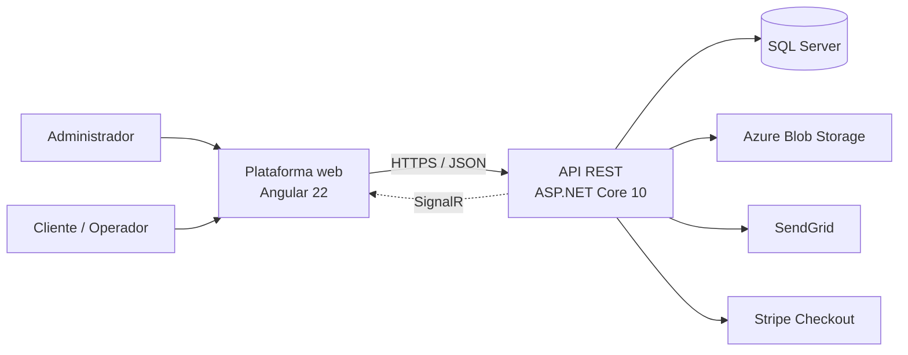

La plataforma se relaciona con cuatro tipos de actores externos: el usuario final, la base de datos relacional, los servicios de nube (correo y archivos) y la pasarela de pagos. La comunicación con el usuario combina solicitudes HTTP y un canal bidireccional para notificaciones.

## 6.3 Vista de contenedores

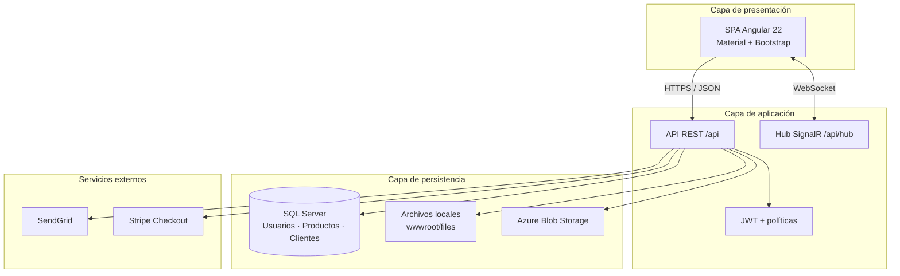

## 6.4 Arquitectura del backend

El backend se organiza en capas con dependencias unidireccionales:

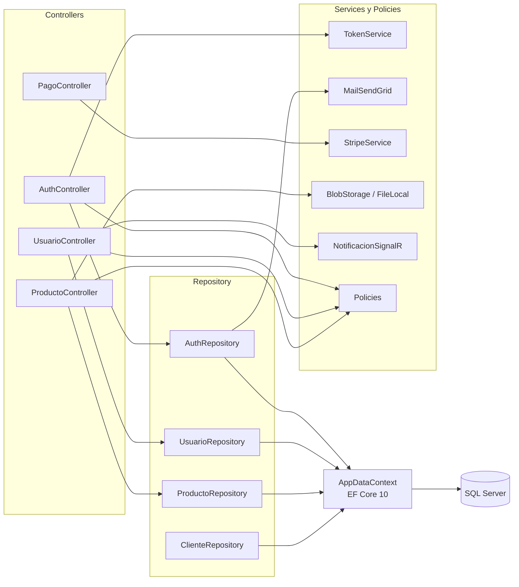

| Capa | Responsabilidad | Componentes representativos |
|---|---|---|
| **Controladores** | Exponer endpoints, validar entrada y coordinar respuestas | `AuthController`, `UsuarioController`, `ProductoController`, `PagoController` |
| **Repositorios** | Encapsular consultas y operaciones de persistencia | `AuthRepository`, `UsuarioRepository`, `ProductoRepository`, `ClienteRepository` |
| **Servicios** | Resolver capacidades transversales e integraciones | `TokenService`, `MailSendGrid`, `StripeService`, `BlobStorage`, `FileLocal`, `NotificacionSignalR` |
| **Políticas** | Evaluar requisitos de autorización | `StatusUserHandler`, `RolHandler` |
| **Contexto de datos** | Mapear entidades y ejecutar migraciones | `AppDataContext`, migraciones de EF Core |

## 6.5 Arquitectura del frontend

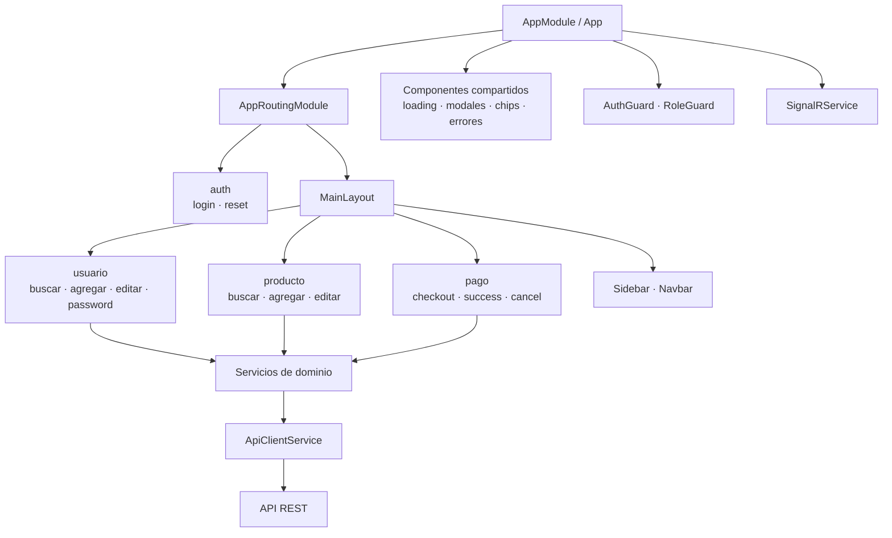

| Elemento | Responsabilidad |
|---|---|
| `AppModule` y `App` | Arranque, configuración global y layout raíz |
| `AppRoutingModule` | Definición de rutas y carga diferida por módulo |
| `SingleLayoutComponent` | Contenedor de autenticación |
| `MainLayoutComponent` | Contenedor de la aplicación autenticada |
| `MainSideBar` y `MainNavBar` | Navegación y acciones de sesión |
| Componentes de dominio | Pantallas de usuarios, productos y pagos |
| `ApiClientService` | Cliente HTTP centralizado con token Bearer |
| `SessionService` | Persistencia y decodificación de la sesión |
| `AuthGuard` y `RoleGuard` | Protección de rutas por sesión y rol |
| `SignalRService` | Conexión y recepción de notificaciones |
| Componentes compartidos | Carga, modales, chips, validación, estados vacíos y archivos |

## 6.6 Stack tecnológico

### Backend

| Tecnología | Versión | Uso |
|---|---|---|
| .NET | 10 | Plataforma de ejecución |
| ASP.NET Core | 10 | API REST, middleware y hospedaje |
| Entity Framework Core | 10 | ORM, migraciones y consultas |
| SQL Server | — | Base de datos relacional |
| JWT Bearer | 10 | Autenticación y validación de tokens |
| SignalR | 10 | Comunicación en tiempo real |
| Swashbuckle / OpenAPI | 10 / 10 | Documentación interactiva de la API |
| SendGrid | 9 | Correo transaccional con plantillas |
| Stripe.net | 52 | Checkout y sesiones de pago |
| Azure Blob Storage | 12 / 9 | Almacenamiento de imágenes en la nube |

### Frontend

| Tecnología | Versión | Uso |
|---|---|---|
| Angular | 22 | Framework SPA |
| TypeScript | 6 | Tipado estático |
| Angular Material + CDK | 22 | Componentes de interfaz |
| Bootstrap | 5.3 | Utilidades y rejilla responsiva |
| RxJS | 7.8 | Programación reactiva |
| jwt-decode | 4 | Lectura de claims en el cliente |
| @microsoft/signalr | 10 | Cliente de notificaciones |
| Vitest + jsdom | 4 / 28 | Pruebas unitarias |
| Prettier | 3.8 | Formato de código |

### Herramientas y operación

| Herramienta | Uso |
|---|---|
| .NET CLI | Compilación, ejecución y migraciones |
| npm | Gestión de dependencias y scripts |
| SPA Proxy | Integración de Angular con la API en desarrollo |
| Swagger UI | Exploración y prueba de endpoints |
| Git y GitHub | Control de versiones y colaboración |

## 6.7 Estructura del repositorio

```text
IngeniaX2026_App/
├── App_NetCoreAngular.Server/
│   ├── Controllers/          # Endpoints HTTP
│   ├── Repository/           # Acceso a datos por dominio
│   ├── EntityFramework/      # Contexto, paginación y migraciones
│   ├── Models/               # Entidades, formularios y vistas
│   ├── Services/             # Token, correo, SignalR, storage y Stripe
│   ├── Policies/             # Requisitos y handlers de autorización
│   ├── Enums/                # Estados, roles y tipos del sistema
│   ├── Utility/              # Hash, archivos, GUID y mensajes
│   └── Program.cs            # Composición e inicio de la API
├── app_netcoreangular.client/
│   ├── src/app/              # Módulo y enrutamiento raíz
│   ├── src/components/       # Módulos funcionales y compartidos
│   ├── src/containers/       # Layouts y navegación
│   ├── src/models/           # Contratos de API y tipos
│   ├── src/utils/            # Servicios, guards y constantes
│   └── public/               # Recursos estáticos
├── docs/                     # Documentación del producto
└── App_NetCoreAngular.slnx   # Solución .NET
```

## 6.8 Patrones y convenciones

| Patrón | Aplicación |
|---|---|
| **Repositorio** | Aísla el acceso a datos y facilita pruebas y sustitución |
| **Inyección de dependencias** | Registro centralizado en `Program.cs` |
| **DTO / ViewModel** | Modelos específicos para formularios, vistas y respuestas |
| **Respuesta uniforme** | `ResponseApi<T>` con `Success`, `Payload`, `Error` y `Paginator` |
| **Paginación** | `PageQuery<T>` con tamaño máximo de 25 registros |
| **Soft delete** | Estado `Baja` para preservar historial |
| **Guards** | Protección de rutas por sesión y rol |
| **Lazy loading** | Carga de módulos Angular bajo demanda |
| **Señales** | Estado reactivo en componentes Angular |
| **Servicios de dominio** | Encapsulan llamadas HTTP por módulo |

## 6.9 Entornos y configuración

| Entorno | API | SPA | Documentación |
|---|---|---|---|
| Desarrollo | `http://localhost:5044` y `https://localhost:7272` | `https://localhost:4200` | Swagger UI y OpenAPI |
| Producción | Dominio corporativo con HTTPS | Servida como archivos estáticos | OpenAPI deshabilitado o protegido |

**Claves de configuración** (sin valores en este documento):

| Clave | Propósito |
|---|---|
| `TokenSettings:Secret` | Firma de tokens JWT |
| `TokenSettings:Issuer` | Emisor válido del token |
| `TokenSettings:Audience` | Audiencia válida del token |
| `SqlServer:DefaultConnection` | Conexión a SQL Server |
| `BlobApi` | Conexión a Azure Blob Storage |
| `FileServer:Local` | Directorio local de archivos |
| `SendgridApi` | Credencial de SendGrid |
| `StripeApi` | Credencial de Stripe |

Las credenciales **deben** gestionarse mediante variables de entorno, secretos de usuario o un almacén de secretos; nunca deben versionarse en el repositorio.

---

# 7. Módulos y funcionalidades

La plataforma se organiza en ocho módulos funcionales. Cada uno agrupa sus pantallas, servicios, modelos y reglas de negocio, y se apoya en los servicios transversales descritos en el capítulo 6.

## 7.1 Autenticación y gestión de sesión

**Propósito**: garantizar que solo usuarios identificados y habilitados accedan a la plataforma, y mantener una sesión coherente entre el cliente y la API.

**Actores**: visitante, usuario autenticado.

| Funcionalidad | Descripción |
|---|---|
| Inicio de sesión | Validación de credenciales contra la base de datos y emisión de un JWT |
| Token de acceso | Token firmado con claims de identidad, rol y estado, con vigencia de 5 días |
| Sesión en el cliente | Almacenamiento del token y decodificación de claims para personalizar la interfaz |
| Cierre de sesión | Eliminación de la sesión local y redirección al login |
| Restablecimiento de contraseña | Generación de una contraseña temporal, actualización y envío por correo |
| Protección de rutas | Guards que validan token, vigencia, autenticidad y rol |
| Renovación | Redirección al login cuando el token expira o es inválido |

**Reglas de negocio**

1. Solo los usuarios con estado `Activo` pueden iniciar sesión.
2. La contraseña se compara mediante el hash almacenado; nunca se conserva en texto plano.
3. El token incluye los claims `id`, `user`, `guid`, `rol`, `stat`, `nom` e `img`.
4. Las rutas privadas redirigen al login conservando la URL de retorno.
5. El cierre de sesión elimina el token y restablece la identidad en memoria.

**Pantallas y rutas**

| Ruta | Componente | Acceso |
|---|---|---|
| `/auth/login` | `LoginComponent` | Público |
| `/auth/reset` | `ResetPasswordComponent` | Público |
| `/` | Redirección a login | Público |

## 7.2 Usuarios

**Propósito**: administrar las cuentas de la organización, sus datos de contacto, su rol y su estado operativo.

**Actores**: administrador.

| Funcionalidad | Descripción |
|---|---|
| Alta de usuario | Registro con nombre, usuario, correo, teléfono, contraseña y rol |
| Consulta | Listado paginado con filtro por nombre o usuario y filtro por rol |
| Detalle | Obtención de un usuario por su identificador público (`Guid`) |
| Edición | Actualización de datos personales y rol |
| Cambio de estado | Activación, desactivación, baja o eliminación lógica |
| Cambio de contraseña | Actualización segura de la credencial |
| Imagen de perfil | Carga de imagen local o remota |
| Eliminación | Baja lógica que preserva la trazabilidad |
| Bienvenida | Envío de correo de bienvenida tras el alta |

**Reglas de negocio**

1. El `Username` debe ser único en el sistema.
2. La contraseña debe tener al menos 5 caracteres.
3. Todo usuario nuevo se crea con estado `Activo`.
4. La baja lógica utiliza el estado `Baja` y excluye al usuario de los listados.
5. Solo el rol `Admin` puede administrar usuarios.
6. Las imágenes admitidas son PNG, JPG, JPEG, SVG o GIF, con un máximo de 5 MB.

**Pantallas y rutas**

| Ruta | Componente | Función |
|---|---|---|
| `/usuario` | `UsuarioBuscarComponent` | Listado, filtro y acciones |
| `/usuario/agregar` | `UsuarioAgregarComponent` | Alta de usuario |
| `/usuario/editar/:guid` | `UsuarioEditarComponent` | Edición de datos |
| Diálogo | `UsuarioEditarPasswordComponent` | Cambio de contraseña |

## 7.3 Clientes

**Propósito**: mantener el registro de las organizaciones o personas con las que se relaciona el negocio, como base para la operación comercial y el seguimiento.

**Actores**: administrador, operador comercial.

| Funcionalidad | Descripción |
|---|---|
| Alta de cliente | Registro de nombre, descripción y fecha de alta |
| Consulta | Listado de clientes con estado y datos principales |
| Detalle | Ficha individual del cliente |
| Edición | Actualización de datos de contacto y descripción |
| Estado | Activación, desactivación o baja lógica |
| Búsqueda | Localización por nombre o descripción |
| Historial | Asociación futura con pagos y actividad comercial |

**Reglas de negocio**

1. El nombre y la descripción son obligatorios.
2. La fecha de alta se registra automáticamente.
3. Los clientes dados de baja no aparecen en las consultas operativas.
4. La información del cliente se conserva por trazabilidad histórica.

## 7.4 Productos

**Propósito**: mantener el catálogo comercial con información confiable de identificación, precio, existencia e imagen.

**Actores**: administrador, operador comercial.

| Funcionalidad | Descripción |
|---|---|
| Alta de producto | Registro de nombre, código, descripción, precio, existencia e imagen |
| Consulta | Listado paginado con filtro por nombre o código |
| Ordenamiento | Por código o nombre, ascendente o descendente |
| Detalle | Ficha completa del producto |
| Edición | Actualización de datos, precio y existencia |
| Eliminación | Baja lógica del catálogo |
| Imagen local | Carga en el servidor y almacenamiento en `wwwroot` |
| Imagen en nube | Carga en Azure Blob Storage |
| Notificación | Aviso en tiempo real al registrar un producto |

**Reglas de negocio**

1. El código del producto debe ser único.
2. El precio y la existencia se almacenan con precisión decimal de 12,2.
3. El precio y la existencia no pueden ser negativos.
4. Los productos con estado `Baja` no se muestran en el catálogo.
5. La imagen es opcional y se valida por extensión y tamaño.
6. La eliminación es lógica para preservar el historial.
7. La creación exitosa genera una notificación al usuario que la realiza.

**Pantallas y rutas**

| Ruta | Componente | Función |
|---|---|---|
| `/producto` | `ProductoBuscarComponent` | Catálogo, filtros y acciones |
| `/producto/agregar` | `ProductoAgregarComponent` | Alta de producto |
| `/producto/editar/:id` | `ProductoEditarComponent` | Edición de producto |

## 7.5 Pagos

**Propósito**: habilitar el cobro en línea de productos mediante una pasarela especializada, con una experiencia de pago confiable y un retorno claro a la aplicación.

**Actores**: cliente, operador comercial.

| Funcionalidad | Descripción |
|---|---|
| Inicio de checkout | Envío de código de producto, identificador de precio y cantidad |
| Sesión de pago | Creación de una sesión hospedada en Stripe |
| Redirección | Envío del usuario a la URL segura de Stripe |
| Éxito | Confirmación visual al finalizar el pago |
| Cancelación | Mensaje y opción de reintento |
| Confirmación | Registro del resultado y notificación al usuario |

**Reglas de negocio**

1. La cantidad debe ser un entero positivo.
2. El identificador de precio debe corresponder a un precio válido de Stripe.
3. El monto se calcula en la pasarela a partir del precio y la cantidad.
4. La confirmación definitiva del pago se valida con los eventos de Stripe.
5. Los datos sensibles de la tarjeta nunca pasan por la aplicación.

**Pantallas y rutas**

| Ruta | Componente | Función |
|---|---|---|
| `/pago` | `PagoStripeComponent` | Captura de cantidad e inicio de checkout |
| `/pago/success` | `PagoSuccessComponent` | Confirmación de pago |
| `/pago/cancel` | `PagoCancelComponent` | Cancelación y reintento |

## 7.6 Notificaciones en tiempo real

**Propósito**: informar a los usuarios sobre eventos relevantes del negocio en el momento en que ocurren.

**Actores**: usuarios autenticados.

| Funcionalidad | Descripción |
|---|---|
| Conexión autenticada | El cliente se conecta al hub con su token JWT |
| Identificación | El usuario se identifica mediante su identificador en la cadena de consulta |
| Notificación dirigida | El servidor envía mensajes al usuario destinatario |
| Canales | Suscripción y cancelación de grupos de notificación |
| Reconexión | Reintentos automáticos con intervalos configurables |
| Presentación | Alerta visual y registro de notificaciones en la interfaz |

**Reglas de negocio**

1. Solo los usuarios autenticados pueden conectarse al hub.
2. El token se transmite en la cadena de consulta para la conexión WebSocket.
3. Las notificaciones se dirigen por identificador de usuario.
4. La pérdida de conexión no bloquea la operación; el cliente reintenta automáticamente.
5. Los mensajes deben ser breves, accionables y no contener datos sensibles.

**Eventos previstos**

| Evento | Origen | Destinatario |
|---|---|---|
| `ReceiveNotificationUser` | Alta de producto | Usuario que realizó el alta |
| `ReceiveNotificationAll` | Avisos generales | Todos los conectados |
| `ReceiveNotification` | Mensajes de sistema | Usuario o grupo |

## 7.7 Experiencia compartida

**Propósito**: ofrecer una experiencia consistente, accesible y predecible en todos los módulos.

| Componente | Función |
|---|---|
| `LoadingComponent` | Indicador de operaciones en curso |
| `ModalEliminarComponent` | Confirmación de acciones destructivas |
| `ModalExitoComponent` | Confirmación de operaciones exitosas |
| `ChipStatusComponent` | Representación visual del estado |
| `ErrorInputComponent` | Mensajes de validación por campo |
| `FileInputComponent` | Selección y vista previa de archivos |
| `SinResultadosComponent` | Estado vacío en búsquedas |
| `NotificacionAlertaComponent` | Presentación de notificaciones en tiempo real |

**Principios de experiencia**

1. Toda operación asíncrona muestra retroalimentación visual.
2. Los errores se presentan junto al campo que los origina.
3. Las acciones destructivas requieren confirmación.
4. Los estados vacíos explican el siguiente paso.
5. La interfaz es responsiva y conserva la legibilidad en móvil.
6. Los colores y textos de estado son consistentes en todos los módulos.

## 7.8 Navegación, layout y perfil

**Propósito**: proporcionar una estructura de navegación clara y un punto de acceso a la identidad del usuario.

| Funcionalidad | Descripción |
|---|---|
| Layout de autenticación | Contenedor limpio para login y restablecimiento |
| Layout principal | Estructura con barra lateral, barra superior y área de contenido |
| Barra lateral | Acceso a usuarios y productos |
| Barra superior | Identidad, perfil y cierre de sesión |
| Perfil | Consulta y actualización de datos del usuario |
| Control por rol | Visibilidad de opciones según el rol |
| Redirección inicial | Envío al panel correspondiente tras el login |

## 7.9 Matriz de permisos

| Capacidad | Admin | Cliente / Operador | Visitante |
|---|---|---|---|
| Iniciar sesión | Sí | Sí | Sí |
| Restablecer contraseña | Sí | Sí | Sí |
| Gestionar usuarios | Sí | No | No |
| Consultar usuarios | Sí | No | No |
| Gestionar clientes | Sí | Sí | No |
| Gestionar productos | Sí | Sí | No |
| Consultar catálogo | Sí | Sí | No |
| Iniciar checkout | Sí | Sí | No |
| Recibir notificaciones | Sí | Sí | No |
| Acceder a Swagger | Solo desarrollo | Solo desarrollo | Solo desarrollo |

---

# 8. Modelo de datos

## 8.1 Principios de modelado

- **Claves primarias sustitutas** de tipo entero para eficiencia relacional.
- **Identificador público** (`Guid`) para usuarios, evitando exponer claves internas.
- **Fechas de auditoría** `DateCreated` y `DateUpdated` en entidades principales.
- **Eliminación lógica** mediante el estado `Baja` para conservar historial.
- **Precisión decimal** `12,2` para montos y existencias.
- **Restricciones de longitud** alineadas con la interfaz y la validación.
- **Sin claves foráneas físicas** en la línea base; las relaciones se gestionan en la capa de aplicación y se incorporarán al modelo según la evolución.

## 8.2 Entidades

### Usuario

| Campo | Tipo | Nulo | Regla |
|---|---|---|---|
| `UsuarioId` | `bigint` | No | Clave primaria, identidad |
| `Guid` | `nvarchar(512)` | No | Identificador público único |
| `Username` | `nvarchar(100)` | No | Correo o usuario de acceso, único |
| `Password` | `nvarchar(256)` | No | Hash de la contraseña |
| `Nombre` | `nvarchar(250)` | No | Nombre visible |
| `ImagenPerfil` | `nvarchar(250)` | Sí | Ruta o URL de la imagen |
| `Email` | `nvarchar(50)` | Sí | Correo de contacto |
| `Telefono` | `nvarchar(250)` | Sí | Teléfono de contacto |
| `Rol` | `int` | No | `Admin` o `Cliente` |
| `DateCreated` | `datetime` | No | Fecha de alta |
| `DateUpdated` | `datetime` | Sí | Última actualización |
| `Estado` | `int` | No | `Activo`, `Inactivo`, `Eliminado` o `Baja` |

### Producto

| Campo | Tipo | Nulo | Regla |
|---|---|---|---|
| `ProductoId` | `bigint` | No | Clave primaria, identidad |
| `Nombre` | `nvarchar(250)` | No | Nombre comercial |
| `Codigo` | `nvarchar(50)` | No | Código único |
| `Descripcion` | `nvarchar(500)` | No | Descripción del producto |
| `Imagen` | `nvarchar(250)` | Sí | Ruta o URL de la imagen |
| `Precio` | `decimal(12,2)` | No | Precio unitario |
| `Existencia` | `decimal(12,2)` | No | Unidades disponibles |
| `DateCreated` | `datetime` | No | Fecha de alta |
| `DateUpdated` | `datetime` | Sí | Última actualización |
| `Estado` | `int` | No | Estado del producto |

### Cliente

| Campo | Tipo | Nulo | Regla |
|---|---|---|---|
| `ClienteId` | `bigint` | No | Clave primaria, identidad |
| `Nombre` | `nvarchar(250)` | No | Nombre o razón social |
| `Descripcion` | `nvarchar(500)` | No | Descripción o notas |
| `FechaAlta` | `datetime` | No | Fecha de registro |
| `Estado` | `int` | No | Estado del cliente |

## 8.3 Enumeraciones

### Estado

| Valor | Nombre | Significado |
|---|---|---|
| 1 | `Activo` | Registro operativo |
| 2 | `Inactivo` | Registro suspendido temporalmente |
| 4 | `Eliminado` | Registro eliminado lógicamente |
| 99 | `Baja` | Registro dado de baja, excluido de consultas |

### RolUsuario

| Valor | Nombre | Alcance |
|---|---|---|
| 1 | `Admin` | Administración completa |
| 2 | `Cliente` | Operación comercial |

## 8.4 Diagrama entidad-relación

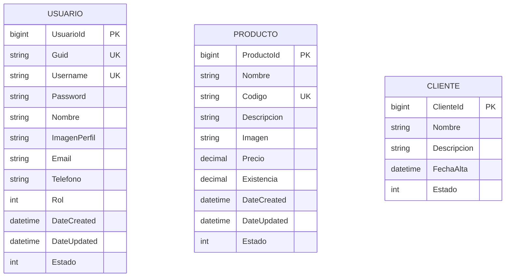

> Las relaciones entre entidades son lógicas en la línea base. La incorporación de claves foráneas físicas se evaluará junto con la ampliación del dominio de pagos y actividad comercial.

## 8.5 Reglas de integridad y auditoría

1. `Username` y `Codigo` deben ser únicos.
2. Las fechas se almacenan en UTC y se presentan en la zona horaria del usuario.
3. Toda actualización debe registrar `DateUpdated`.
4. La eliminación lógica cambia el estado, no borra la fila.
5. Los montos y existencias se validan antes de persistir.
6. Las imágenes se referencian por ruta o URL, nunca por contenido binario en la base.
7. La cuenta administradora inicial se define en la configuración de arranque y debe cambiar su contraseña en el primer acceso.

## 8.6 Migraciones y datos iniciales

El esquema se versiona con migraciones de Entity Framework Core:

| Migración | Propósito |
|---|---|
| `Usuario` | Creación de la tabla de usuarios y cuenta inicial |
| `Productos` | Creación de la tabla de productos |
| `Clientes` | Creación de la tabla de clientes |

**Datos iniciales**: se siembra una cuenta con rol `Admin` para permitir el primer acceso. La contraseña de esa cuenta debe definirse de forma segura y cambiarse tras el primer inicio de sesión.

---

# 9. API y contratos

## 9.1 Convenciones generales

| Aspecto | Convención |
|---|---|
| Prefijo | `/api` |
| Formato | JSON (`application/json`) |
| Codificación | UTF-8 |
| Autenticación | `Authorization: Bearer <token>` |
| Respuesta | `ResponseApi<T>` |
| Paginación | `page` con base 1; tamaño fijo de 25 registros |
| Fechas | ISO 8601 en UTC |
| Errores | HTTP 400 con `ResponseApi.Error` descriptivo |
| Documentación | Swagger UI en desarrollo |

### Estructura de respuesta

```json
{
  "success": true,
  "payload": {},
  "error": null,
  "paginator": {
    "count": 0,
    "pageIndex": "0",
    "pageSize": 25,
    "total": 120
  }
}
```

### Códigos de estado

| Código | Uso |
|---|---|
| 200 | Operación exitosa |
| 400 | Validación, credenciales o regla de negocio incumplida |
| 401 | Token ausente, inválido o expirado |
| 403 | Rol o estado sin permiso suficiente |
| 404 | Recurso no encontrado |
| 500 | Error no controlado |

## 9.2 Autenticación

| Método | Ruta | Acceso | Descripción |
|---|---|---|---|
| POST | `/api/auth/login` | Anónimo | Valida credenciales y devuelve un JWT |
| POST | `/api/auth/reset` | Anónimo | Genera una contraseña temporal y la envía por correo |

**Entrada de login**

```json
{
  "email": "usuario@dominio.com",
  "password": "contraseña"
}
```

**Salida de login**

```json
{
  "success": true,
  "payload": {
    "id": "1",
    "usuario": "usuario@dominio.com",
    "token": "eyJhbGciOiJIUzI1NiIs..."
  }
}
```

## 9.3 Usuarios

| Método | Ruta | Política | Descripción |
|---|---|---|---|
| POST | `/api/usuario/agregar` | JWT + `RolAdmin` | Alta de usuario |
| GET | `/api/usuario/buscar` | JWT + `RolAdmin` | Listado paginado con filtro y rol |
| GET | `/api/usuario/obtener/{guid}` | JWT + `RolAdmin` | Detalle por identificador público |
| PUT | `/api/usuario/editar/{guid}` | JWT + `RolAdmin` | Edición de datos |
| PUT | `/api/usuario/estado` | JWT + `RolAdmin` | Cambio de estado |
| PUT | `/api/usuario/password/{guid}` | JWT + `RolAdmin` | Cambio de contraseña |
| DELETE | `/api/usuario/eliminar/{guid}` | JWT + `RolAdmin` | Baja lógica |

**Parámetros de búsqueda**

| Parámetro | Tipo | Valores | Predeterminado |
|---|---|---|---|
| `page` | entero | 1..n | 1 |
| `sortBy` | cadena | `user`, `user_desc`, `nombre`, `nombre_desc`, `fecha_desc` | `user_desc` |
| `rol` | entero | 0, 1, 2 | 0 |
| `filtro` | cadena | Texto libre | Vacío |

## 9.4 Productos

| Método | Ruta | Política | Descripción |
|---|---|---|---|
| POST | `/api/producto/agregar` | `UserActive` | Alta de producto |
| GET | `/api/producto/buscar` | `UserActive` | Catálogo paginado con filtro y orden |
| GET | `/api/producto/obtener/{id}` | `UserActive` | Detalle de producto |
| PUT | `/api/producto/editar/{id}` | `UserActive` | Edición de producto |
| DELETE | `/api/producto/eliminar/{id}` | `UserActive` | Baja lógica |
| PUT | `/api/producto/img` | `UserActive` | Carga de imagen local |
| PUT | `/api/producto/imgBlob` | `UserActive` | Carga de imagen en Azure Blob |

**Parámetros de búsqueda**

| Parámetro | Tipo | Valores | Predeterminado |
|---|---|---|---|
| `page` | entero | 1..n | 1 |
| `sortBy` | cadena | `codigo`, `codigo_desc`, `nombre`, `nombre_desc` | `nombre_desc` |
| `filtro` | cadena | Texto libre | Vacío |

**Carga de imagen**

- Formato: `multipart/form-data`.
- Campo: archivo de imagen.
- Extensiones: `png`, `jpg`, `jpeg`, `svg`, `gif`.
- Tamaño máximo: 5 MB.

## 9.5 Clientes

> Contrato previsto en la visión del producto. Su implementación completa forma parte del Horizonte 1.

| Método | Ruta | Política | Descripción |
|---|---|---|---|
| POST | `/api/cliente/agregar` | `UserActive` | Alta de cliente |
| GET | `/api/cliente/buscar` | `UserActive` | Listado de clientes |
| GET | `/api/cliente/obtener/{id}` | `UserActive` | Detalle de cliente |
| PUT | `/api/cliente/editar/{id}` | `UserActive` | Edición de cliente |

## 9.6 Pagos

| Método | Ruta | Acceso | Descripción |
|---|---|---|---|
| POST | `/api/pago/checkout` | JWT + `UserActive` | Crea una sesión de Stripe y devuelve la URL |

**Entrada de checkout**

```json
{
  "codigo": "PROD-001",
  "priceId": "price_xxxxxxxxxxxx",
  "cantidad": 1
}
```

**Salida de checkout**

```json
{
  "success": true,
  "payload": "https://checkout.stripe.com/c/pay/..."
}
```

## 9.7 Hub de notificaciones

| Aspecto | Valor |
|---|---|
| Ruta | `/api/hub` |
| Autenticación | JWT en `access_token` de la cadena de consulta |
| Identificación | Parámetro `userId` |
| Métodos del cliente | `SubscribeToChannel`, `UnsubscribeFromChannel` |
| Eventos del servidor | `ReceiveNotificationUser`, `ReceiveNotificationAll`, `ReceiveNotification` |

## 9.8 Errores y validación

| Situación | Respuesta |
|---|---|
| Campo obligatorio ausente | 400 con mensaje de validación |
| Credenciales incorrectas | 400 con “Datos del usuario incorrectos” |
| Usuario duplicado | 400 con mensaje de existencia |
| Token expirado | 401 |
| Rol insuficiente | 403 |
| Archivo inválido | 400 con mensaje de archivo |
| Error de base de datos | 400 con mensaje de conexión |

---

# 10. Seguridad

## 10.1 Modelo de autenticación

La plataforma utiliza **JWT Bearer** firmado con HMAC-SHA256. El token se emite tras validar las credenciales y contiene los claims necesarios para la autorización y la personalización de la interfaz.

| Claim | Contenido |
|---|---|
| `id` | Identificador interno del usuario |
| `user` | Nombre de usuario |
| `guid` | Identificador público |
| `rol` | Rol numérico |
| `stat` | Estado del usuario |
| `nom` | Nombre visible |
| `img` | Imagen de perfil |
| `jti` | Identificador único del token |

**Características**

- Firma simétrica con secreto configurado fuera del código.
- Validación de emisor, audiencia, vigencia y firma.
- Expiración de 5 días.
- Transmisión exclusiva por HTTPS.
- Almacenamiento en el cliente con eliminación en el cierre de sesión.

**Requisitos de endurecimiento**

1. Rotación periódica del secreto de firma.
2. Tokens de acceso de corta duración con refresh tokens.
3. Lista de revocación o versionado de tokens.
4. Bloqueo temporal tras intentos fallidos.
5. Autenticación multifactor para roles administrativos.

## 10.2 Autorización por políticas

| Política | Requisito | Efecto |
|---|---|---|
| `UserActive` | Claim `stat` igual a `Activo` | Permite operar solo a cuentas habilitadas |
| `RolAdmin` | Claim `rol` igual a `Admin` | Reserva capacidades administrativas |

Los handlers evalúan los claims del token y conceden o deniegan el requisito. Las rutas del frontend replican la validación mediante `AuthGuard` y `RoleGuard` para ofrecer una experiencia coherente; la decisión definitiva siempre reside en la API.

## 10.3 Protección de la API

| Control | Implementación |
|---|---|
| Transporte | Redirección a HTTPS |
| CORS | Origen permitido explícito en desarrollo |
| Validación | Anotaciones de datos en los modelos |
| Inyección SQL | Consultas parametrizadas de EF Core |
| XSS | Escape automático de Angular |
| CSRF | Token Bearer, sin cookies de sesión |
| Exposición | Swagger habilitado solo en desarrollo |
| Errores | Mensajes controlados sin detalles internos |

## 10.4 Gestión de archivos

1. Validar extensión y tamaño antes de almacenar.
2. Generar un nombre único para evitar colisiones.
3. Almacenar fuera del código fuente.
4. Servir imágenes mediante rutas controladas.
5. Eliminar archivos huérfanos en un proceso programado.
6. Analizar el contenido en busca de malware en producción.

## 10.5 Gestión de secretos

- Los secretos **no deben** versionarse en el repositorio.
- En desarrollo se utilizan secretos de usuario o variables de entorno.
- En producción se utiliza un almacén de secretos gestionado.
- Las claves deben rotarse ante cualquier exposición.
- El acceso a los secretos debe limitarse por rol operativo.

## 10.6 Privacidad y cumplimiento

La plataforma trata datos personales de usuarios y clientes. La organización debe:

1. informar la finalidad del tratamiento;
2. obtener el consentimiento cuando corresponda;
3. limitar la recolección a los datos necesarios;
4. definir plazos de conservación;
5. atender solicitudes de acceso, rectificación y eliminación;
6. registrar accesos y cambios relevantes.

## 10.7 Lista de verificación de seguridad

- [ ] Secretos fuera del repositorio y rotados.
- [ ] HTTPS obligatorio en producción.
- [ ] Hash de contraseñas con algoritmo adaptativo y sal.
- [ ] Política de contraseñas y bloqueo por intentos.
- [ ] Refresh tokens y revocación.
- [ ] MFA para administradores.
- [ ] Rate limiting en autenticación y pagos.
- [ ] Validación de firma de webhooks de Stripe.
- [ ] Análisis de dependencias y contenedores.
- [ ] Registro de auditoría de acciones administrativas.
- [ ] Respaldo y restauración probados.
- [ ] Revisión de permisos por mínimo privilegio.

---

# 11. Flujos clave

## 11.1 Inicio de sesión

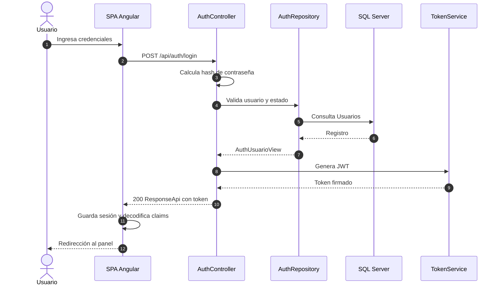

## 11.2 Restablecimiento de contraseña

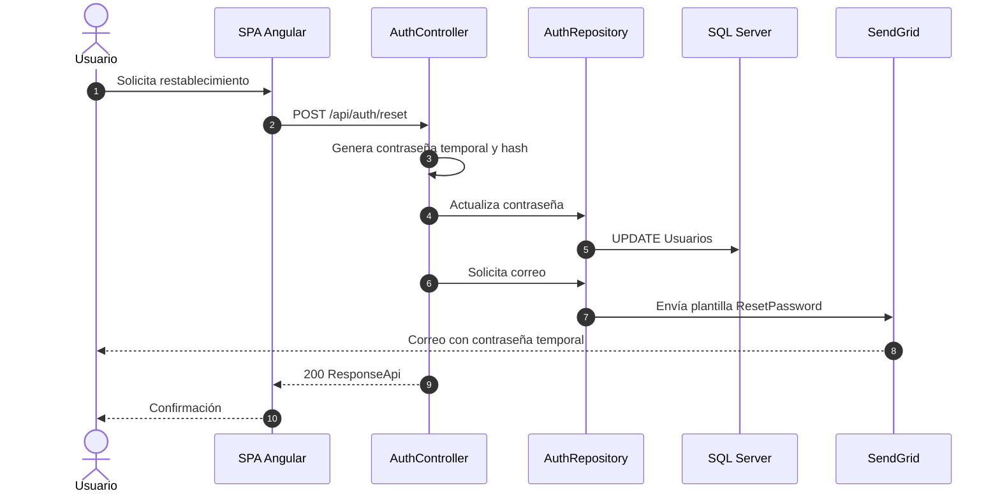

## 11.3 Alta de producto y notificación

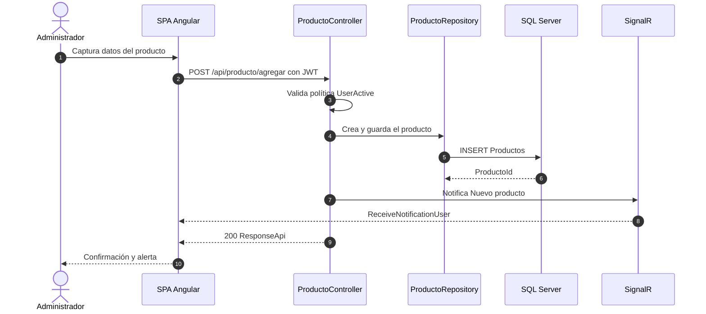

## 11.4 Carga de imagen

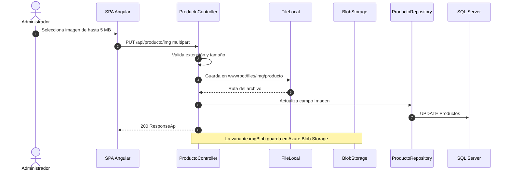

## 11.5 Checkout

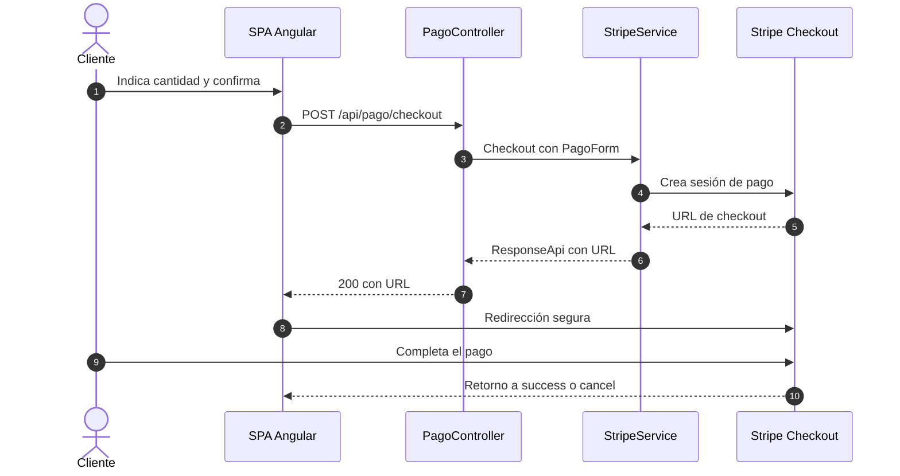

## 11.6 Búsqueda paginada

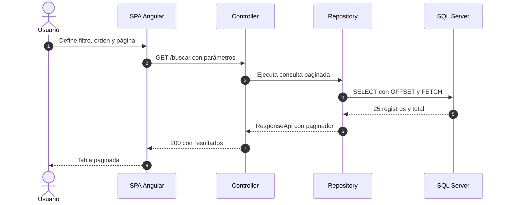

---

# 12. Requisitos no funcionales

| Categoría | Requisito | Meta |
|---|---|---|
| **Rendimiento** | Respuesta de consultas paginadas | p95 menor a 500 ms |
| **Rendimiento** | Carga inicial de la SPA | Menor a 3 s en banda ancha |
| **Rendimiento** | Notificación en tiempo real | Menos de 2 s desde el evento |
| **Disponibilidad** | Operación mensual | 99.5 % o superior |
| **Escalabilidad** | API sin estado | Escalado horizontal |
| **Escalabilidad** | SignalR | Backplane distribuido en múltiples instancias |
| **Seguridad** | Transporte | HTTPS obligatorio |
| **Seguridad** | Contraseñas | Hash adaptativo con sal |
| **Seguridad** | Sesión | Expiración y revocación |
| **Usabilidad** | Retroalimentación | Menos de 100 ms para acciones locales |
| **Usabilidad** | Responsividad | Escritorio, tableta y móvil |
| **Accesibilidad** | Contraste y navegación | WCAG 2.1 AA como objetivo |
| **Compatibilidad** | Navegadores | Últimas dos versiones de Chrome, Edge, Firefox y Safari |
| **Internacionalización** | Idioma base | Español, con estructura preparada para otros idiomas |
| **Observabilidad** | Registro | Logs estructurados con correlación |
| **Observabilidad** | Salud | Endpoint de verificación de estado |
| **Mantenibilidad** | Cobertura | Pruebas unitarias y de integración en módulos críticos |
| **Mantenibilidad** | Formato | Prettier y análisis estático |
| **Respaldo** | Base de datos | Respaldo diario con restauración probada |
| **Respaldo** | Archivos | Redundancia y versionado en Blob |
| **Recuperación** | RPO | Menor a 24 horas |
| **Recuperación** | RTO | Menor a 4 horas |

---

# 13. Despliegue y operación

## 13.1 Topología de despliegue

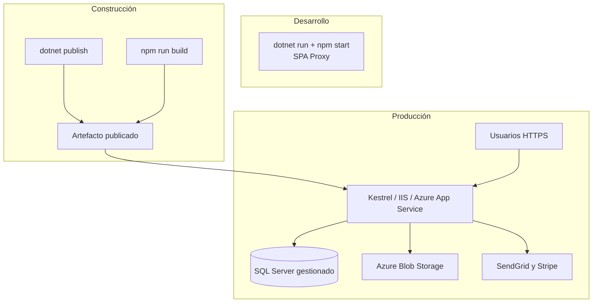

## 13.2 Requisitos previos

| Componente | Requisito |
|---|---|
| Sistema operativo | Windows, Linux o macOS para desarrollo |
| .NET SDK | 10 |
| Node.js | 22 o superior |
| npm | 10 o superior |
| SQL Server | 2019 o superior |
| Certificado HTTPS | Válido en producción |
| Cuentas externas | Stripe, SendGrid y Azure Storage |
| Navegador | Chrome, Edge, Firefox o Safari actualizado |

## 13.3 Configuración por entorno

1. Definir las claves de configuración en el entorno.
2. Configurar la cadena de conexión a SQL Server.
3. Registrar las credenciales de Stripe y SendGrid.
4. Configurar el contenedor de Azure Blob.
5. Ajustar el origen permitido por CORS.
6. Verificar la vigencia del certificado HTTPS.
7. Validar la zona horaria y la cultura.

## 13.4 Compilación y ejecución local

```bash
# Compilar la solución
dotnet build App_NetCoreAngular.slnx

# Ejecutar la API
dotnet run --project App_NetCoreAngular.Server/App_NetCoreAngular.Server.csproj

# Compilar la SPA
cd app_netcoreangular.client
npm run build

# Ejecutar la SPA en desarrollo
npm start

# Ejecutar pruebas del frontend
npm test
```

**Direcciones locales**

| Servicio | URL |
|---|---|
| API HTTP | `http://localhost:5044` |
| API HTTPS | `https://localhost:7272` |
| Swagger UI | `http://localhost:5044/swagger/index.html` |
| OpenAPI | `http://localhost:5044/openapi/v1.json` |
| SPA | `https://localhost:4200` |

## 13.5 Publicación

1. Compilar la SPA en modo producción.
2. Publicar la API con `dotnet publish -c Release`.
3. Copiar los archivos estáticos de la SPA al directorio `wwwroot`.
4. Configurar el host (Kestrel, IIS o App Service).
5. Aplicar las migraciones de base de datos.
6. Verificar la salud del servicio y los flujos críticos.
7. Habilitar el monitoreo y las alertas.

## 13.6 Base de datos y migraciones

```bash
# Aplicar migraciones
dotnet ef database update --project App_NetCoreAngular.Server

# Crear una nueva migración
dotnet ef migrations add NombreMigracion --project App_NetCoreAngular.Server
```

**Buenas prácticas**

- Revisar el script generado antes de aplicar.
- Ejecutar migraciones en ventanas de mantenimiento.
- Respaldar antes de cambios de esquema.
- No modificar migraciones ya aplicadas.
- Mantener un historial reproducible.

## 13.7 Dependencias externas

| Servicio | Configuración | Verificación |
|---|---|---|
| Stripe | Clave de API y precio de referencia | Checkout de prueba |
| SendGrid | Clave de API y plantillas | Correo de restablecimiento |
| Azure Blob | Cadena de conexión y contenedor | Carga y lectura de imagen |
| SQL Server | Cadena de conexión | Migraciones y consultas |
| HTTPS | Certificado y dominio | Acceso sin advertencias |

## 13.8 Operación, monitoreo y respaldo

| Actividad | Frecuencia | Responsable |
|---|---|---|
| Revisión de logs y errores | Diaria | Operaciones |
| Verificación de salud | Continua | Monitoreo |
| Respaldo de base de datos | Diaria | Operaciones |
| Respaldo de archivos | Diaria | Operaciones |
| Prueba de restauración | Trimestral | Operaciones |
| Rotación de secretos | Semestral | Seguridad |
| Revisión de dependencias | Mensual | Desarrollo |
| Revisión de accesos | Trimestral | Seguridad |

## 13.9 Lista de verificación de despliegue

- [ ] Configuración de entorno completa y sin secretos en el repositorio.
- [ ] Compilación de backend y frontend sin errores.
- [ ] Migraciones aplicadas y verificadas.
- [ ] Certificado HTTPS vigente.
- [ ] CORS restringido al origen correcto.
- [ ] Swagger deshabilitado o protegido en producción.
- [ ] Checkout probado en modo de prueba y producción.
- [ ] Correo transaccional probado.
- [ ] Carga de imágenes local y en Blob probada.
- [ ] Notificaciones en tiempo real verificadas.
- [ ] Respaldo inicial ejecutado.
- [ ] Monitoreo y alertas activos.

---

# 14. Modelo de evolución del producto

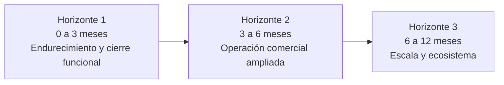

## 14.1 Horizonte 1 — Consolidación

**Objetivo**: asegurar una base sólida, segura y completa para la operación.

| Iniciativa | Resultado esperado |
|---|---|
| Endurecimiento de seguridad | Secretos gestionados, hash adaptativo, bloqueo por intentos, rate limiting |
| Cierre del módulo de clientes | API, pantallas y pruebas de extremo a extremo |
| Alineación de contratos | Frontend y backend con endpoints y modelos consistentes |
| Pruebas de backend | Cobertura de autenticación, usuarios, productos y pagos |
| Integración continua | Compilación, pruebas y análisis automáticos |
| Observabilidad | Logs estructurados, salud y alertas |
| Documentación operativa | Runbook, respaldo y recuperación |

## 14.2 Horizonte 2 — Operación ampliada

**Objetivo**: enriquecer la operación comercial y la experiencia del cliente.

| Iniciativa | Resultado esperado |
|---|---|
| Carrito y múltiples ítems | Checkout con varios productos y totales |
| Webhooks de Stripe | Confirmación confiable del pago y conciliación |
| Movimientos de inventario | Entradas, salidas y alertas de existencias |
| Historial de cliente | Actividad, pagos y documentos |
| Panel de indicadores | Ventas, altas y productos más consultados |
| Auditoría funcional | Registro de acciones administrativas |
| Refresh tokens y MFA | Sesiones más seguras |
| Notificaciones multicanal | Correo, push y centro de notificaciones |

## 14.3 Horizonte 3 — Escala y ecosistema

**Objetivo**: preparar la plataforma para múltiples organizaciones y un ecosistema de integraciones.

| Iniciativa | Resultado esperado |
|---|---|
| Multiempresa | Aislamiento de datos y configuración por organización |
| Aplicación móvil o PWA | Acceso desde cualquier dispositivo |
| Integraciones | ERP, CRM, facturación y logística |
| Analítica avanzada | Tendencias, pronósticos y segmentación |
| Internacionalización | Múltiples idiomas y monedas |
| Marketplace de extensiones | Módulos conectables por terceros |
| Automatización | Reglas de negocio y flujos programados |

## 14.4 Priorización de iniciativas

| Iniciativa | Valor | Esfuerzo | Prioridad |
|---|---|---|---|
| Gestión de secretos | Alto | Bajo | Muy alta |
| Hash adaptativo y política de contraseñas | Alto | Medio | Muy alta |
| Módulo de clientes completo | Alto | Medio | Muy alta |
| Pruebas de backend e integración continua | Alto | Medio | Alta |
| Webhooks de Stripe | Alto | Medio | Alta |
| Panel de indicadores | Medio | Medio | Media |
| Carrito multiítem | Medio | Alto | Media |
| Multiempresa | Alto | Alto | Baja en el corto plazo |

---

# 15. Glosario

| Término | Definición |
|---|---|
| **API** | Interfaz de programación que expone operaciones de negocio a través de HTTP |
| **Blob** | Objeto binario almacenado en un servicio de nube |
| **Checkout** | Proceso de pago en línea |
| **Claim** | Atributo incluido en un token de identidad |
| **CORS** | Mecanismo que controla el acceso desde orígenes distintos |
| **DTO** | Objeto de transferencia de datos entre capas |
| **EF Core** | ORM de .NET para acceso a datos y migraciones |
| **Guard** | Componente que protege una ruta del frontend |
| **HTTPS** | Protocolo HTTP cifrado con TLS |
| **JWT** | Token web JSON firmado para autenticación |
| **Migración** | Cambio versionado del esquema de base de datos |
| **Paginación** | División de resultados en páginas de tamaño fijo |
| **Política** | Requisito de autorización evaluado por la API |
| **SignalR** | Biblioteca de comunicación en tiempo real |
| **Soft delete** | Baja lógica que conserva el registro |
| **SPA** | Aplicación de una sola página |
| **Webhook** | Notificación HTTP enviada por un servicio externo |

---

# 16. Referencias

## 16.1 Documentación técnica

- ASP.NET Core: <https://learn.microsoft.com/aspnet/core>
- Entity Framework Core: <https://learn.microsoft.com/ef/core>
- Angular: <https://angular.dev>
- Angular Material: <https://material.angular.dev>
- SignalR: <https://learn.microsoft.com/aspnet/core/signalr>
- Stripe Checkout: <https://stripe.com/docs/payments/checkout>
- SendGrid: <https://docs.sendgrid.com>
- Azure Blob Storage: <https://learn.microsoft.com/azure/storage/blobs>

## 16.2 Estándares

- JWT: <https://datatracker.ietf.org/doc/html/rfc7519>
- OWASP ASVS: <https://owasp.org/www-project-application-security-verification-standard/>
- WCAG 2.1: <https://www.w3.org/WAI/WCAG21/quickref/>

## 16.3 Documentos del repositorio

| Documento | Ubicación |
|---|---|
| Guía general del proyecto | `AGENTS.md` |
| Guía del backend | `App_NetCoreAngular.Server/AGENTS.md` |
| Guía del frontend | `app_netcoreangular.client/AGENTS.md` |
| Descripción del producto | `docs/IngeniaX2026_Descripcion_Producto.md` |

---

# 17. Anexos

## Anexo A. Catálogo consolidado de endpoints

| Módulo | Método | Ruta | Autenticación |
|---|---|---|---|
| Autenticación | POST | `/api/auth/login` | Anónimo |
| Autenticación | POST | `/api/auth/reset` | Anónimo |
| Usuarios | POST | `/api/usuario/agregar` | JWT + `RolAdmin` |
| Usuarios | GET | `/api/usuario/buscar` | JWT + `RolAdmin` |
| Usuarios | GET | `/api/usuario/obtener/{guid}` | JWT + `RolAdmin` |
| Usuarios | PUT | `/api/usuario/editar/{guid}` | JWT + `RolAdmin` |
| Usuarios | PUT | `/api/usuario/estado` | JWT + `RolAdmin` |
| Usuarios | PUT | `/api/usuario/password/{guid}` | JWT + `RolAdmin` |
| Usuarios | DELETE | `/api/usuario/eliminar/{guid}` | JWT + `RolAdmin` |
| Productos | POST | `/api/producto/agregar` | JWT + `UserActive` |
| Productos | GET | `/api/producto/buscar` | JWT + `UserActive` |
| Productos | GET | `/api/producto/obtener/{id}` | JWT + `UserActive` |
| Productos | PUT | `/api/producto/editar/{id}` | JWT + `UserActive` |
| Productos | DELETE | `/api/producto/eliminar/{id}` | JWT + `UserActive` |
| Productos | PUT | `/api/producto/img` | JWT + `UserActive` |
| Productos | PUT | `/api/producto/imgBlob` | JWT + `UserActive` |
| Clientes | POST | `/api/cliente/agregar` | JWT + `UserActive` |
| Clientes | GET | `/api/cliente/buscar` | JWT + `UserActive` |
| Clientes | GET | `/api/cliente/obtener/{id}` | JWT + `UserActive` |
| Clientes | PUT | `/api/cliente/editar/{id}` | JWT + `UserActive` |
| Pagos | POST | `/api/pago/checkout` | JWT + `UserActive` |
| Notificaciones | WS | `/api/hub` | JWT |

## Anexo B. Enumeraciones del sistema

| Enumeración | Valores |
|---|---|
| `Estado` | `Activo` = 1, `Inactivo` = 2, `Eliminado` = 4, `Baja` = 99 |
| `RolUsuario` | `Admin` = 1, `Cliente` = 2 |
| `TypeAttachment` | Zip, Rar, Pdf, Jpg, Png, Svg, Json, Csv, Xml, Excel, Word |
| `TypeTemplate` | Bienvenida, ResetPassword, CorreoPrueba |

## Anexo C. Correspondencia de componentes

| Necesidad | Backend | Frontend |
|---|---|---|
| Inicio de sesión | `AuthController`, `TokenService` | `LoginComponent`, `AuthService` |
| Restablecimiento | `AuthController`, `MailSendGrid` | `ResetPasswordComponent` |
| Usuarios | `UsuarioController`, `UsuarioRepository` | `UsuarioBuscar`, `UsuarioAgregar`, `UsuarioEditar` |
| Productos | `ProductoController`, `ProductoRepository` | `ProductoBuscar`, `ProductoAgregar`, `ProductoEditar` |
| Clientes | `ClienteRepository` | Modelo `Cliente` |
| Pagos | `PagoController`, `StripeService` | `PagoStripe`, `PagoSuccess`, `PagoCancel` |
| Notificaciones | `MainHub`, `NotificacionSignalR` | `SignalRService`, `NotificacionAlerta` |
| Archivos | `FileLocal`, `BlobStorage` | `FileInputComponent` |
| Sesión | JWT y políticas | `SessionService`, guards |

## Anexo D. Evidencia técnica del documento

| Fuente | Contenido utilizado |
|---|---|
| `Program.cs` | Composición, autenticación, CORS, SignalR, Stripe y Swagger |
| `Controllers/*.cs` | Endpoints, políticas y contratos |
| `Repository/*.cs` | Consultas, filtros, orden y paginación |
| `Models/*.cs` | Entidades, formularios y respuestas |
| `EntityFramework/*` | Contexto, migraciones y paginación |
| `Services/*` | Token, correo, Stripe, almacenamiento y SignalR |
| `Policies/*` | Autorización por estado y rol |
| `app-routing-module.ts` | Rutas y carga diferida |
| `ConstantsApiRoutes.ts` | Contratos consumidos por la SPA |
| `package.json` y `*.csproj` | Versiones y dependencias |
| `appsettings.json` | Claves de configuración, sin valores |

---

**Fin del documento.**
